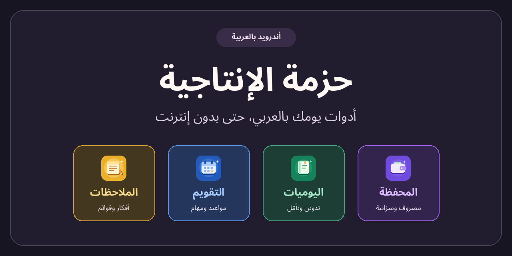
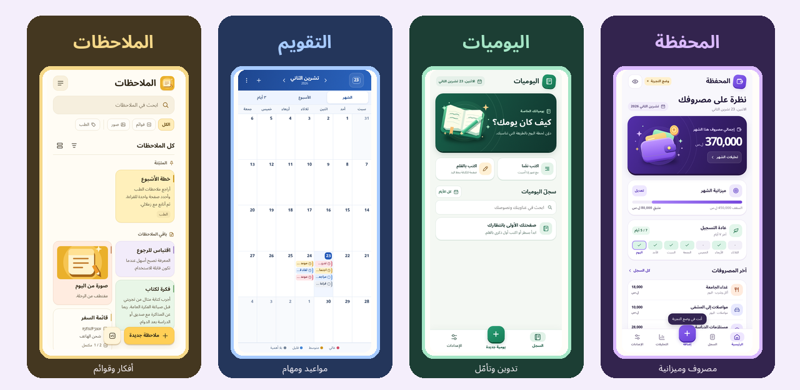

  

<h1 align="center">حزمة الإنتاجية</h1>

<a href="#download"><b>حمّل التطبيقات</b></a> · <a href="#preview">شاهد الواجهات</a> · <a href="README.en.md">English</a>

أربع أدوات عربية مفتوحة المصدر لأندرويد. نظّم مصروفك ووقتك، دوّن يومك، والتقط أفكارك. كل تطبيق مستقل، بواجهة من اليمين إلى اليسار ويعمل دون حساب أو اتصال. البيانات تبقى على جهازك، وتقدر تصدّرها عندما تحتاجها.

## حمّل التطبيقات

| التطبيق | ماذا يفعل؟ | أندرويد | التحميل |
| --- | --- | --- | --- |
| **المحفظة** | مصروفات يومية وميزانيات شهرية، مع ملخّصات وتنبيهات إنفاق اختيارية | 7.0+ | [APK · 1.1][wallet] |
| **اليوميات** | تدوين بالنص أو القلم، وإرفاق الصور، وأسئلة للتأمّل وتذكيرات اختيارية | 7.0+ | [APK · 1.1][journal] |
| **التقويم** | مواعيد ومهام مرمّزة بالأولوية، في عرض شهري وأسبوعي وعلى ٣ أيام | 8.0+ | [APK · 1.1][calendar] |
| **الملاحظات** | بطاقات وقوائم تحقق وصور ووسوم، مع بحث عربي وحفظ تلقائي | 8.0+ | [APK · 1.0][notes] |

حمّل التطبيق الذي تحتاجه وافتح ملف APK على جهازك. إذا طلب أندرويد إذن التثبيت للمصدر الذي فتح منه الملف، راجع اسم المصدر قبل المتابعة. إذا كانت عندك نسخة سابقة من الحزمة، ثبّت النسخة الموقّعة فوقها كي تبقى بياناتك. تجد بصمات SHA-256 في [ملف التحقق](downloads/SHA256SUMS.txt).

## الواجهات

  

## بياناتك قابلة للنقل

| التطبيق | نسخة احتياطية قابلة للاستعادة | تصدير للاستخدام خارج التطبيق |
| --- | --- | --- |
| المحفظة | JSON | CSV للمصاريف |
| اليوميات | ZIP | HTML لليوميات والصور وخط اليد |
| التقويم | JSON | ICS للمواعيد والمهام |
| الملاحظات | ZIP | Markdown مع الصور داخل ZIP |

يستورد تطبيق الملاحظات كذلك النصوص والقوائم والوسوم من أرشيف Google Takeout لتطبيق Keep. النسخ الاحتياطية تُحفظ من **الإعدادات** في المكان الذي تختاره.

## الكود والمساهمة

المحفظة في [Almahfaza](apps/Almahfaza)، واليوميات في [Alyawmiyat](apps/Alyawmiyat)، والتقويم في [Altaqwim](apps/Altaqwim)، والملاحظات في [Almolahazat](apps/Almolahazat). لكل تطبيق مشروع Gradle مستقل وتعليمات بناء خاصة به.

ابدأ من [دليل البناء والمساهمة](CONTRIBUTING.md). كود الحزمة الأصلي مرخّص بموجب [Apache License 2.0](LICENSE)، وتحتفظ الخطوط والمكوّنات المضمّنة بتراخيصها.

[wallet]: https://github.com/mohsaqraq/arabic-productivity-suite/raw/refs/heads/main/downloads/Almahfaza_1.1.apk
[journal]: https://github.com/mohsaqraq/arabic-productivity-suite/raw/refs/heads/main/downloads/Alyawmiyat_1.1.apk
[calendar]: https://github.com/mohsaqraq/arabic-productivity-suite/raw/refs/heads/main/downloads/Altaqwim_1.1.apk
[notes]: https://github.com/mohsaqraq/arabic-productivity-suite/raw/refs/heads/main/downloads/Almolahazat_1.0.apk
